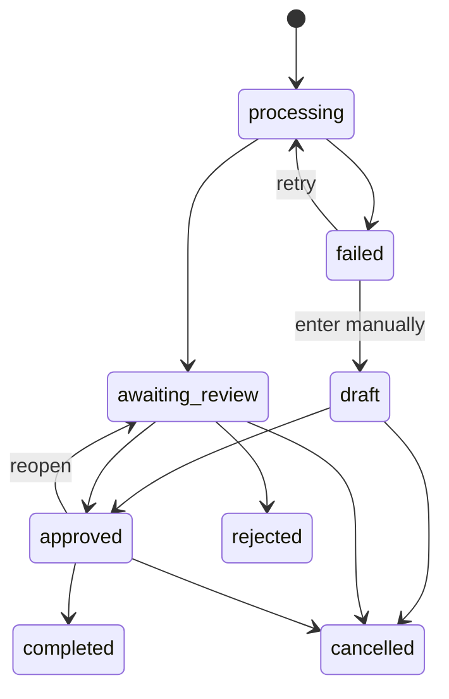

# ChatReceipt API

The backend serves three groups of endpoints from one FastAPI app. The interactive reference, generated
from the code, is at `/docs` (OpenAPI JSON at `/openapi.json`) on any running API.

| Group | Prefix | Who uses it | Auth |
| --- | --- | --- | --- |
| Website | `/api/...` | The Next.js site: read screenshots, calculate, print | None; rate limited per visitor |
| WhatsApp records | `/api/records...` | The records page | Bearer token from a sign-in link sent on WhatsApp |
| Transaction engine | `/api/v1/...` | Integrations and tools | Bearer session token |

## Conventions

**Errors.** Every error has the same shape, with a stable `code` to branch on and a `message` written
for people:

```json
{"error": {"code": "version_conflict", "message": "This transaction changed while you were working on it. Reload it and try again.", "details": null}}
```

**Authentication (v1).** `Authorization: Bearer <token>`. Tokens are opaque; only their hash is stored.
An operator creates an API account and a token with `python -m scripts.api_session create <reference>`
(see that script's help). Missing or expired tokens get `401` with `authentication_required` or
`session_expired`. Every v1 query runs under a database role restricted to the caller's own rows
(row-level security), so another account's IDs return `404`, never their data.

**Idempotency.** Writes accept `Idempotency-Key` (8–128 of `A-Z a-z 0-9 _ . : -`). A retry with the same
key and body gets the first answer back; the same key with a different body gets `422
idempotency_key_reused`. The key is stored in the same database transaction as the change.

**Concurrency.** Every change to a transaction names the version it was based on (`expected_version`).
If the transaction has changed since, the answer is `409 version_conflict` and nothing is written.

**Pagination.** Lists return `next_cursor`; pass it back as `cursor`. `limit` is 1–100 (default 20).

**Rate limits.** Per visitor on the website group (see `EXTRACTION_RATE_LIMIT` and friends in
`app/config.py`), per account on v1 (`V1_*_RATE_LIMIT`). Over the limit: `429 rate_limited` with
`Retry-After`.

## Website group

| Method | Path | Purpose |
| --- | --- | --- |
| GET | `/api/health` | Liveness: the process answers |
| GET | `/api/health/ready` | Readiness: database reachable and migrations applied (`503` otherwise) |
| GET | `/api/config` | Currencies, upload limits and whether screenshot reading is available |
| POST | `/api/extractions` | Screenshots (multipart) → proposed record with field evidence and review reasons |
| POST | `/api/transactions/calculate` | Draft → totals, outstanding amount and validation issues |
| POST | `/api/documents/preview` | Draft → the record as HTML |
| POST | `/api/documents/pdf`, `/png` | Draft → the record as a file |

Nothing sent to this group is stored.

## WhatsApp records group

| Method | Path | Purpose |
| --- | --- | --- |
| POST | `/api/records/session` | Exchange the one-time code from a WhatsApp link for a session |
| POST | `/api/records/session/end` | Sign out |
| GET | `/api/records`, `/api/records/{id}` | The signed-in customer's saved records |

The WhatsApp webhook (`GET`/`POST /api/whatsapp/webhook`) is not in the OpenAPI document: Meta calls it,
and every delivery must carry a valid `X-Hub-Signature-256` made with the app secret.

## Transaction engine (v1)

| Method | Path | Purpose |
| --- | --- | --- |
| POST | `/api/v1/uploads` | Upload screenshots or a text export; returns IDs, sizes and SHA-256 fingerprints |
| GET, DELETE | `/api/v1/uploads/{id}` | Read or delete an upload |
| POST | `/api/v1/conversations` | Start processing up to 20 uploads, or pasted `text`, as one conversation; returns a job |
| GET, DELETE | `/api/v1/conversations/{id}` | Read or delete a conversation and its files |
| GET | `/api/v1/conversations/{id}/messages` | The normalised messages, speakers and sources |
| GET | `/api/v1/jobs/{id}` | Job state, attempts and failure reason |
| POST | `/api/v1/jobs/{id}/cancel` | Cancel a queued or running job |
| GET | `/api/v1/transactions` | List; filters `state`, `payment_status`, `q`, `date_from`, `date_to`; `sort` = `created_at`, `total` or `transaction_date` (prefix `-` for descending) |
| POST | `/api/v1/transactions` | Create a record by hand |
| GET | `/api/v1/transactions/{id}` | The record, its calculation, validation, per-field states (including the possible-duplicate check), the analysis and the actions available now |
| GET | `/api/v1/transactions/{id}/history` | Every change: who, when, before and after, reason, engine version |
| GET | `/api/v1/transactions/{id}/versions/{n}` | A past version, unchanged |
| POST | `/api/v1/transactions/{id}/review` | Apply corrections (`set`, `add_item`, `remove_item`, `add_adjustment`, `remove_adjustment`, `confirm`) |
| POST | `/api/v1/transactions/{id}/approve` | Approve; refused while a blocking field or an unacknowledged possible duplicate remains |
| POST | `/api/v1/transactions/{id}/reject`, `/cancel`, `/complete`, `/reopen` | State changes, with a reason where it matters |
| POST | `/api/v1/transactions/{id}/enter-manually` | Give up on extraction and fill the record by hand |
| POST | `/api/v1/transactions/{id}/retry` | Process a failed record again |
| POST | `/api/v1/transactions/{id}/receipts` | Issue a receipt for the current approved version |
| GET | `/api/v1/receipts`, `/api/v1/receipts/{id}` | Receipts; each names the exact version it records |
| GET | `/api/v1/receipts/{id}/document` | The receipt PDF |
| POST | `/api/v1/receipts/{id}/void` | Void a receipt (receipts are never edited) |
| DELETE | `/api/v1/account` | Erase the account; body `{"confirm": "DELETE MY DATA"}` |

### Transaction states



Only `draft` and `awaiting_review` can be edited. Receipts can be issued in `approved` and `completed`.
`completed`, `rejected` and `cancelled` are final.

### Outgoing events (optional)

With `WEBHOOK_URL` and `WEBHOOK_SECRET` set, the engine delivers `transaction.approved`,
`receipt.generated`, `transaction.completed` and `processing.failed` from a transactional outbox:
written in the same database transaction as the change, retried with backoff (up to
`WEBHOOK_MAX_ATTEMPTS`), and kept for inspection when delivery fails. Each request carries:

- `X-ChatReceipt-Event-Id` (stable across retries: deduplicate on it) and `X-ChatReceipt-Event-Type`
- `X-ChatReceipt-Signature: t=<unix seconds>,v1=<hex>`, where `v1` is HMAC-SHA256 of `<t>.<raw body>`
  with the shared secret. Reject requests whose `t` is more than five minutes old.

The engine works the same with no webhook configured.
