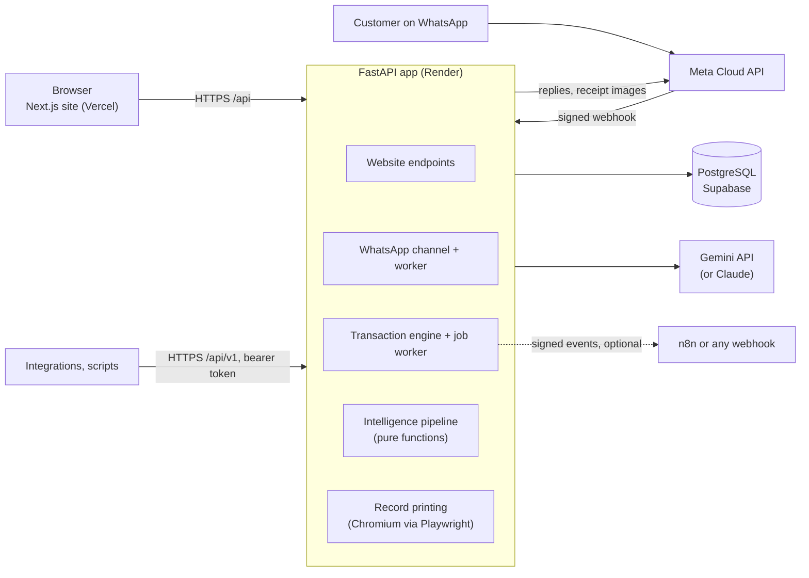
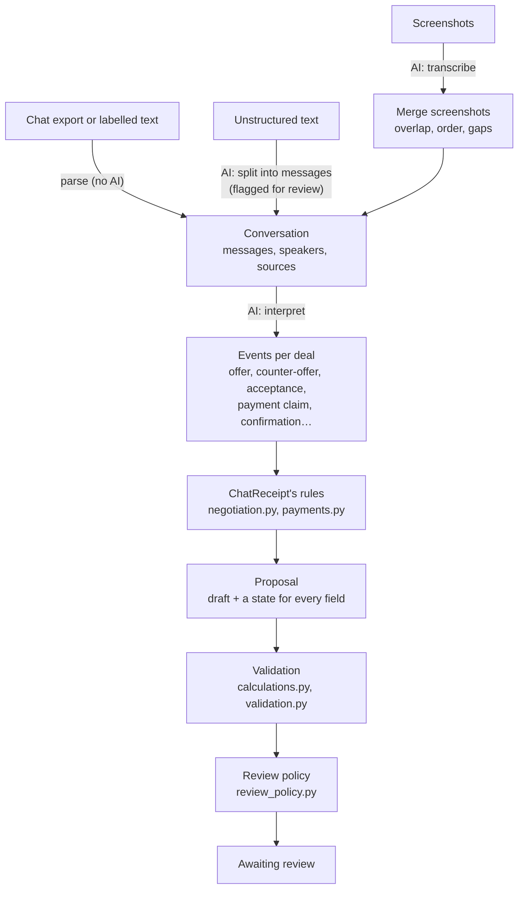

# ChatReceipt architecture

ChatReceipt is a modular monolith: one Next.js website and one FastAPI application with a PostgreSQL
database. The AI reads and interprets conversations; ChatReceipt's own code decides every amount, state,
approval and duplicate.

## Three ways in

### 1. The website (stateless)

`POST /api/extractions` sends the screenshots to the AI provider with one structured-output request
(`app/extraction`), validates the answer against a strict schema, and returns a proposed record with
evidence and review reasons. The browser holds the draft while the person reviews it; every total comes
from `POST /api/transactions/calculate` (`app/calculations.py`, Decimal arithmetic). The record is
printed from one HTML template (`app/documents/templates/record.html`) to HTML, PDF or PNG. Nothing is
stored.

### 2. The WhatsApp channel

`app/whatsapp`. The webhook checks Meta's signature, stores each message once (the message ID is the
primary key, so repeated deliveries are harmless) and returns at once. A worker then:

- collects albums of screenshots into one submission and reads them with the same extraction as the
  website;
- holds a conversation with the customer: a review summary, one question at a time, typed corrections
  ("it's 20k", "the buyer paid 35k") read by deterministic patterns first and the AI only as a fallback,
  and a one-tap fix when the stated balance and the amounts disagree (`reconcile.py`);
- saves confirmed records to `transactions` and sends the receipt image through an outbound queue
  (`whatsapp_outbound`) with retries and Meta's 24-hour window in mind.

Customers are identified by Meta's business-scoped user ID; the phone number is optional. A customer
sees their saved records on the website through a one-time sign-in link sent in WhatsApp.

### 3. The transaction engine (`/api/v1`)

For integrations: uploads and pasted text become conversations, processed as background jobs, reviewed
and approved through the API, with full history and versioned receipts. It uses the multi-stage
intelligence pipeline below. The WhatsApp channel and the website still use the single-step extraction.

## The intelligence pipeline

- **The AI reports events, not conclusions.** For each deal it lists who offered, countered, accepted,
  promised, claimed or confirmed what, citing message keys. Its own "agreed" reading is kept only as a
  cross-check.
- **Rules decide.** `negotiation.py` follows offers to the accepted one (a later change without a new
  acceptance makes the price contradictory); `payments.py` separates promises, claims, confirmations,
  disputes and refunds. Every figure must appear in the message it cites, or it is flagged.
- **Every field gets a state** (`fields.py`): confirmed, inferred, missing, contradictory, invalid or
  needs review, with evidence, candidates and reasons. Contradictory values are left empty, with the
  candidates listed for the person to choose.
- **One policy object** (`review_policy.py`) decides which states block approval. Its settings come from
  `REVIEW_*` environment variables, and the evaluation measures what each choice costs.

All of `app/intelligence` is pure: no database or network access outside the two AI calls in
`pipeline.py`, so every rule is unit-tested and stored AI answers can be re-scored after a rule change.

## Data

Everything lives in the `chatreceipt` schema (`app/db/migrations`, applied by `python -m app.db.migrate`,
which records a checksum for each file).

| Area | Tables |
| --- | --- |
| Customers and access | `customers`, `web_sign_in_codes`, `web_sessions` |
| WhatsApp | `whatsapp_inbound`, `whatsapp_submissions`, `whatsapp_outbound` |
| Records | `transactions` (shared by WhatsApp and the engine) |
| Engine intake | `uploads`, `conversations`, `conversation_sources`, `conversation_participants`, `conversation_messages`, `ocr_results`, `extraction_runs` |
| Engine records | `extracted_transactions`, `transaction_items`, `transaction_versions`, `review_decisions`, `transaction_events`, `receipts` |
| Reliability | `processing_jobs`, `job_attempts`, `worker_heartbeats`, `outbox_events`, `idempotency_keys`, `storage_erasures` |

- **Tenant isolation in the database.** v1 requests run under the `chatreceipt_tenant` role
  (`SET LOCAL ROLE`) with the customer ID in a transaction setting, and row-level security policies
  limit every table to that customer's rows.
- **History can't be rewritten.** Versions, decisions and events are append-only (grants and triggers).
  A receipt records one version; a change means a new version, and an issued receipt is voided rather
  than edited.
- **Money is Decimal** end to end and stored as `numeric`; the backend recalculates on every write.

## Background work

Both workers run inside the API process by default, or as their own processes
(`python -m app.whatsapp.worker`, `python -m app.engine.worker`).

- Jobs are rows claimed with `FOR UPDATE SKIP LOCKED`, under a lease with a fencing token, so a worker
  that stalls can't complete work another worker took over. One active job per subject.
- Failures are classified as retryable or permanent; retries back off up to `ENGINE_JOB_MAX_ATTEMPTS`.
- A job's results and its completion are written in the same transaction; events for integrations go
  through the outbox in that same transaction.
- No network call happens inside a database transaction.

## Observability

Structured JSON log events (`app/observability.py`) with request IDs; access logs keep only the path,
never query strings; errors log the exception type and stack frames, never values that could hold
conversation content or phone numbers. `/api/health` and `/api/health/ready` for hosts, and a
token-protected `/api/metrics` with counters and timings.

## Module map

| Path | What it holds |
| --- | --- |
| `frontend/app`, `frontend/components` | Pages: landing, `/create` (upload → review → preview), `/records` |
| `backend/app/api` | Website, records and WhatsApp routes; `api/v1` for the engine |
| `backend/app/extraction` | Single-step extraction: prompt, schema, Gemini and Claude providers |
| `backend/app/intelligence` | Conversation model, parsing, transcription, interpretation, rules, proposals |
| `backend/app/records` | Lifecycle states, review operations, duplicate detection |
| `backend/app/engine` | Ingestion, jobs, processing, transactions, receipts, outbox, worker |
| `backend/app/whatsapp` | Webhook events, client, conversation flow, corrections, worker |
| `backend/app/documents` | Record template, fonts and the Chromium renderer |
| `backend/app/db` | Connection pool, migrations and their runner |
| `backend/evals` | Evaluations against the real AI provider |
| `backend/scripts` | WhatsApp simulator, API session tool |

Deployment on free plans is described in [docs/deployment.md](docs/deployment.md); the reasons behind
the main choices are in [TECHNICAL_DECISIONS.md](TECHNICAL_DECISIONS.md).
